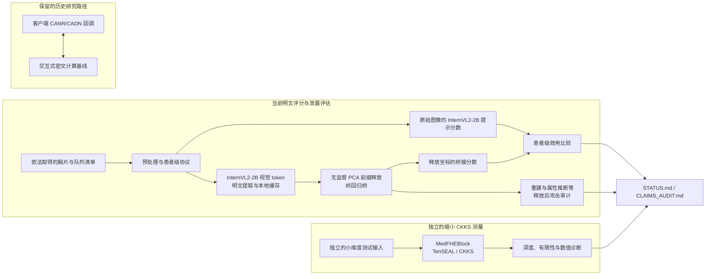

# 现行架构

本页是“当前已实现且有记录”的架构，而不是完整端到端 FHE-VLM 的设计目标。
当前科学证据覆盖明文 InternVL2-2B 前缀释放、隐私攻击审计和一个缩小的 CKKS
测量块；历史交互式刷新路径单独标注，不应与无交互纯 FHE 结果合并。

当前主评分行使用 PCA 与桥接分数。仿射、空间释放和 Qwen adapter 是仓库内其他实现或历史对照，
不应据此推断它们通过了当前主终点。不同审计使用的输入和队列随协议变化，并非都使用同一
rank-1999 释放。CKKS 测量使用独立的小规模输入，不是 InternVL2 token 路径的加密执行。

仓库包含当前明文评分路径、独立的缩小 CKKS 测量，以及保留的历史交互式计算基线。
现行科学结论只覆盖状态页中明确列出的明文开发集结果和已记录的 CKKS 测量。

## 仍在仓库里、但不是现行结论的路径

0.4 临床状态编解码器的源码已经删除。ε=3 的记录级本地差分隐私不能挪到近满秩坐标释放上。协议里的默认宽度 `(8, 4, 3.0, 812)` 只属于已删除的编解码配置。

0.3 交互刷新在 `fpavlm/cipher_native/canr.py` 的 `ClientCANREngine` / `ServerCANREngine`。客户端会看到中间激活。这条路径不能写成纯 FHE。

## 现行评分路径

InternVL2-2B 抽出 256 个 token，隐藏维 2048，展平宽度 524288。提示句固定为 `Does this chest X-ray show pneumonia? Answer Yes or No.` 分数是 `logit(Yes) - logit(No)`。

无标签池上的释放是无监督 PCA，再接岭回归桥。通过格是前缀 2000、秩 `n_train - 1`（1999）、零噪声。桥的惩罚是未归一化 gram 上的 `+1*I`。这是明文 InternVL token 的坐标，深度 3 的矩电路不算这些坐标。

攻击器读全 token、秩 1024 或秩 1999，把它们解成 64×64 灰度图。它不选择释放。属性推断使用 token 均值、秩 1024 和秩 1999。

## 已经测量的 CKKS 对象

`MedFHEBlock`，维 64，4 个 token，`poly_act` 次数 1，`poly_norm` 次数 2，token mix 开，CADN 关。参数：`poly_modulus_degree` 32768，`scale_bits` 28，`depth_budget` 6，`multiplicative_depth` 6。一次前向后 `output_depth` 是 5，`output_finite` true。出处：`experiments/results/poly_block_ckks_anchor.json`。TenSEAL 0.3.16 不做自举。这个块的混合器是多项式 token mix。动态自注意力没有实现。网格见 `poly_block_ckks_grid.json`，九个点的 `output_depth` 都是 5。斜率不外推到 InternViT-300M。

历史 0.3 计时使用 N=8192，出处是 `compiled_release_ckks.json` 与 `spatial_quadratic_ckks32.json`。那是另一次测量。

## 深度门

电路学生只有在乘法深度至多 5 时才有资格评分。像素线性图是一次密文乘明文，深度 1。平方学生先做逐元素平方再做线性图，深度 2。两条都已评分，`no_feasible_student` 为 true。把前 L 个 InternViT 块各换成一个已测块，花费 5L：L=2 为 10，L=4 为 20，L=8 为 40。这三档没有评分。

## 多项式视觉塔

替换在评分前锁定。GELU 系数是 `0.1365, 0.5, 0.2045`。Softmax 用注意力分数的平方除以行和，每次计一次自举。LayerNorm 的倒数平方根用 `1 - u/2 + 3*u^2/8`。预写计数是 73 次自举、乘法深度 172。运行结果是 `tokens_finite` false，`first_nonfinite_block` 2，`auc_computed` false。这次通过不会是 FHE 结果，这个塔也不是电路候选。
